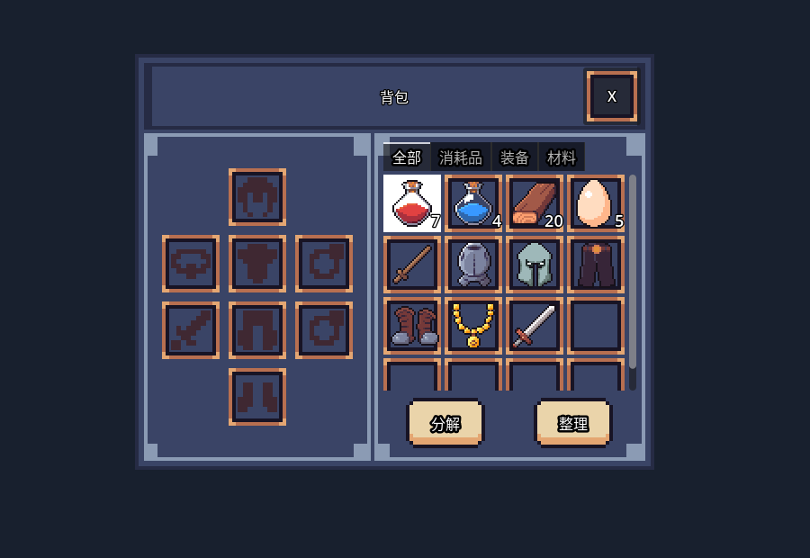

# GodotSimpleInventory

[](https://github.com/LiGameAcademy/GodotSimpleInventory/actions/workflows/inventory.yml)
[](https://github.com/LiGameAcademy/GodotSimpleInventory/stargazers)
[](LICENSE)

[简体中文](README_zh-CN.md) · [Plugin-only distribution](https://github.com/LiGameAcademy/laoli_simple_inventory)

Source, teaching examples and tests for the LaoLi inventory and equipment plugin. Reusable plugin source lives in addons/simple_inventory; this complete Godot project is not intended to be mounted directly at an ARPG addon path.

> For more Godot learning resources and to support future development, visit [LiGameAcademy on Patreon](https://www.patreon.com/cw/LiGameAcademy).

[English Discord](https://discord.gg/5KAqAMU8x5) · [itch.io](https://godot-li.itch.io/)

## Preview



The actual plugin UI with configured demo item stacks; Chinese labels shown. [Capture details](addons/simple_inventory/docs/screenshots/README.md).

## Use the plugin

Install the [plugin-only repository](https://github.com/LiGameAcademy/laoli_simple_inventory) at addons/simple_inventory, fixed to a validated commit or tag. See the [usage guide](addons/simple_inventory/docs/usage.md). Enable the plugin and restart Godot.

The plugin manages item containers, stacking, equipment slots, UI binding and JSON snapshots. The host implements character effects, models, quest policy and disk persistence. Successful acquisitions emit items_received, including full merges; snapshot restore emits no acquisition.

## Develop and validate

Use Godot 4.7.2; compatibility with 4.5 has not been verified. Open project.godot for the teaching example.

```sh
python tools/run_checks.py --godot /absolute/path/to/godot
```

This runs 169 core assertions, 10 UI isolation assertions and 9 isolated plugin contracts. The invalid-ID negative test deliberately prints one ItemManager diagnostic; all unexpected errors fail. Windows editor lifecycle checks are documented in tests/README.md. Interactive drag, scaling and final visual preferences still require manual acceptance.

The authoritative plugin tree stays here. Derive the plugin root using git subtree split --prefix=addons/simple_inventory or git archive HEAD:addons/simple_inventory, then publish a validated snapshot with the identical Git tree. The first distribution commit starts new history so removed unverified assets are not copied into the new repository's history. See [distribution maintenance](docs/plugin_distribution.md). No manual parallel edits to the distribution.

Code is MIT. See [third-party notices](addons/simple_inventory/THIRD_PARTY_NOTICES.md) for asset licenses. Historical lessons need their matching revisions; current APIs are documented in the plugin.
