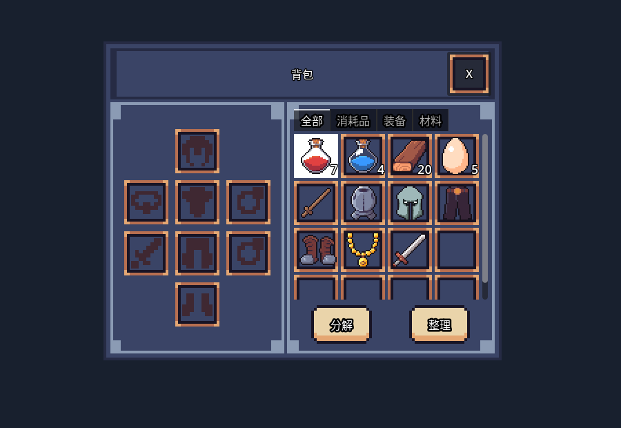

# GodotSimpleInventory

[English](README.md) · [插件发行仓库](https://github.com/LiGameAcademy/laoli_simple_inventory)

老李背包系统的源码、教学示例与测试工程。可复用插件位于addons/simple_inventory；不要把整个示例仓库直接放进ARPG的插件目录。

> 想继续学习 Godot、获取更多项目学习资源并参与交流，欢迎加入[老李游戏学院知识星球](https://wx.zsxq.com/group/28885154818841)。

[中文 Discord](https://discord.gg/V5nuzC2BcJ) · [itch.io 主页](https://godot-li.itch.io/) · [B 站主页](https://space.bilibili.com/8618918)

[截图版本与配置说明](addons/simple_inventory/docs/screenshots/README.md)。

插件负责物品容器、堆叠、装备槽、UI绑定与JSON快照。宿主负责治疗、角色属性/技能/模型、收集任务策略及磁盘存档。成功入包发items_received，完整堆叠也会通知；读档不发送入包事件。

接入其他工程使用[插件发行仓库](https://github.com/LiGameAcademy/laoli_simple_inventory)，固定已验证版本。详见[使用说明](addons/simple_inventory/docs/usage_zh-CN.md)，启用后重启Godot。

当前实测Godot4.7.2，未验证4.5。打开project.godot运行示例；python tools/run_checks.py --godot <路径>执行169项核心断言、10项UI隔离断言与9项空宿主契约。invalid_id负测刻意产生一条ItemManager诊断，其余错误均失败。Windows生命周期验证见tests/README.md；拖拽、缩放和最终外观仍需人工验收。

本仓库addons/simple_inventory是权威源码，发行库由git subtree split生成，不独立修改第二份实现。代码MIT，素材见[单独署名](addons/simple_inventory/THIRD_PARTY_NOTICES.md)。当前接口不代表历史课程已同步修订。
