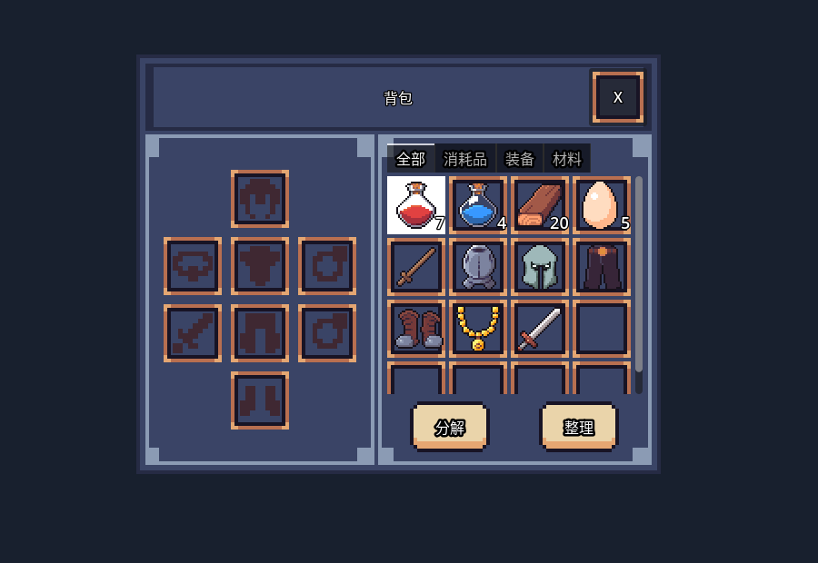

# 老李背包插件

[English](README.md) · [使用说明](docs/usage_zh-CN.md) · [代码许可](LICENSE) · [素材署名](THIRD_PARTY_NOTICES.md)

面向Godot的背包与装备组件：物品实例、堆叠、独占容器、装备槽、安全换装、独立UI与版本1 JSON快照。

> 想继续学习 Godot、获取更多项目学习资源并参与交流，欢迎加入[老李游戏学院知识星球](https://wx.zsxq.com/group/28885154818841)。

[中文 Discord](https://discord.gg/V5nuzC2BcJ) · [itch.io 主页](https://godot-li.itch.io/) · [B 站主页](https://space.bilibili.com/8618918)

当前验证Godot 4.7.2，未验证4.5。本仓库根目录即插件目录，不包含独立游戏工程。

## 界面预览

真实默认UI，取自配置了示例物品的源工程宿主，展示图标、堆叠数量、分类与装备槽布局。截图不代表人工交互验收已经完成。[截图说明](docs/screenshots/README.md)。

## 安装与接入

将本仓库作为子模块放到 addons/simple_inventory，固定已验证标签或提交；也可以复制整个插件目录。具体命令见[使用说明](docs/usage_zh-CN.md)。启用 li_simple_inventory 后重启Godot；既有同名单例保留，冲突需先解决。

宿主配置InventoryComponent、EquipmentComponent、装备槽及物品Resource，向InventoryPanel显式传入组件与使用者。规则不依赖UI。治疗、属性、技能、模型、文件读写和完整存档政策由宿主负责。

items_received(item_id, quantity)通知成功接收的原始数量，包括完整合并堆叠；失败和快照恢复不计入。经add_item转交物品也会通知，宿主决定哪些来源计入收集任务。快照恢复前必须注册物品和装备槽配置。

## 源码与验证

权威源码位于[GodotSimpleInventory](https://github.com/LiGameAcademy/GodotSimpleInventory)的addons/simple_inventory；本发行仓库由git subtree split生成。修改回合源工程，不维护第二份独立实现。

python tools/run_tests.py --godot <Godot路径>验证隔离空宿主；源工程提供完整规则、双UI隔离和编辑器生命周期测试。具体外观与交互仍需宿主验收。代码MIT，素材遵循各自许可。
